<p align="center">
  
</p>

<h1 align="center">outpost</h1>

<h3 align="center">Turn any server into an always-on home for your AI coding agents.</h3>

<p align="center">
  One command turns a fresh server into a secure, signed-in home for your agents, ready for <a href="https://t3.codes">T3 Code</a>.<br>
  The rest keep it healthy, change it as you go, and move everything to a new one, threads and all.
</p>

<p align="center">
  <a href="https://github.com/Beechey/outpost/actions/workflows/ci.yml"></a>
  
  
  
  <a href="LICENSE"></a>
</p>

<p align="center">
  <a href="#quick-start"><b>Quick start</b></a> ·
  <a href="#commands"><b>Commands</b></a> ·
  <a href="docs/guide.md"><b>Guide</b></a> ·
  <a href="docs/how-it-works.md"><b>How it works</b></a> ·
  <a href="CONTRIBUTING.md"><b>Contributing</b></a>
</p>

<p align="center">
  
</p>

## Why outpost

Your agents should keep working when your laptop is closed. T3 Code runs them on any machine; outpost makes that machine, and looks after it.

<table>
<tr>
<td width="33%" valign="top">

### One command

`outpost setup` installs, secures and signs in a bare Ubuntu server in about ten minutes. You approve a few links.

</td>
<td width="33%" valign="top">

### Survives reboots

T3, Docker and Tailscale start at boot. outpost reboots every new server to prove it, then hands it over.

</td>
<td width="33%" valign="top">

### Locked down

Key-only SSH, no root login, a firewall, Docker ports that stay private, and security fixes installed daily.

</td>
</tr>
<tr>
<td valign="top">

### Change your mind

Every choice setup makes has its own command: swap, how your devices connect, sign-ins. `outpost status` shows them all.

</td>
<td valign="top">

### Your way in

T3 Connect from anywhere, or Tailscale for a free, private, unlimited tailnet. Switch any time.

</td>
<td valign="top">

### Moves with you

`outpost move` carries code, unpushed work, T3 threads and agent history to a new server. `outpost backup` keeps a copy on your laptop.

</td>
</tr>
</table>

## Quick start

**1. Install outpost** (needs [Go 1.26+](https://go.dev/dl/))

```bash
go install github.com/Beechey/outpost/cmd/outpost@latest
```

Later, `outpost upgrade` brings it up to date.

<details>
<summary><b>Install Go</b></summary>

| macOS | Ubuntu / Debian | Other |
|---|---|---|
| `brew install go` | `sudo snap install go --classic` | <https://go.dev/dl/> |
</details>

<details>
<summary><b><code>outpost: command not found</code>?</b> Add Go's bin folder to your PATH</summary>

**zsh** (macOS default)
```bash
echo 'export PATH="$HOME/go/bin:$PATH"' >> ~/.zshrc && source ~/.zshrc
```

**bash** (on macOS, use `~/.bash_profile`)
```bash
echo 'export PATH="$HOME/go/bin:$PATH"' >> ~/.bashrc && source ~/.bashrc
```

**fish**
```fish
fish_add_path ~/go/bin
```
</details>

**2. Get a server** with **Ubuntu 24.04**, from any provider or at home, and note its IP.

**3. Set it up**

```bash
outpost setup 203.0.113.7
```

It asks how much swap you want, installs everything, then walks you through the logins. When you see **All set**, open T3 Code, pick the server, add a project with **⌘K → Add Project**, and start prompting.

> [!TIP]
> No root SSH key on the server? outpost asks for the root password once. Using a computer at home? See the [guide](docs/guide.md#1-get-a-server).

## Living with it

Check on a server any time. `status` only looks, and names the command that changes or fixes each part:

```bash
outpost status 203.0.113.7
```

```
203.0.113.7
  • Memory 8 GB, 4 GB of swap, 52 GB of disk free  outpost swap 203.0.113.7
  • Access T3 Connect  outpost access 203.0.113.7
  ✓ T3 Code, Docker and Tailscale running
  ✓ Tailscale signed in
  ✗ Claude not signed in. Fix: outpost login 203.0.113.7 claude
  ✓ GitHub signed in
```

Then change whatever you need, without setting the server up again:

```bash
outpost swap 203.0.113.7 8            # more backup memory, no reboot
outpost access 203.0.113.7 tailscale  # tailnet only, or back with: connect
outpost login 203.0.113.7 claude      # a login expired
outpost update 203.0.113.7            # T3 Code, Claude Code and system packages
outpost backup 203.0.113.7            # a copy of your work on your laptop
```

## Moving on

Switching providers, upgrading, or bringing a server home:

```bash
outpost move 203.0.113.7 198.51.100.4
```

| Moves | Doesn't move |
|---|---|
| Everything in `~/code`, including uncommitted work, unpushed branches and agent worktrees | Logins: approve them again, about a minute |
| T3 Code threads, projects and settings | `node_modules`: reinstalled on demand |
| Claude and Codex history, `CLAUDE.md`, skills and settings | Docker containers and their data |

The new server becomes the same environment in T3 Code, so threads continue where they left off. The old one is switched off with its files untouched, and if the copy fails, it starts again so nothing is lost. [More on moving →](docs/guide.md#move-to-a-new-server)

## Commands

| Command | What it does |
|---|---|
| `outpost setup SERVER` | Prepare a fresh server, or repair one. Safe to re-run. |
| `outpost status SERVER` | See how a server is set up and what needs fixing. Changes nothing. |
| `outpost access SERVER [connect\|tailscale]` | Switch how your devices reach T3. |
| `outpost pair SERVER` | Pair another device, such as your phone, with a Tailscale server. |
| `outpost login SERVER [ACCOUNT]` | Sign in again: `tailscale`, `claude`, `github` or `t3`, or whatever is missing. |
| `outpost swap SERVER [GB]` | Change how much swap a server has. `0` removes it. |
| `outpost update SERVER` | Update T3 Code, Claude Code and system packages. |
| `outpost backup SERVER [FILE]` | Download a server's work to a file on your laptop. |
| `outpost move OLD NEW` | Move everything to a new server. |
| `outpost list` / `outpost forget SERVER` | See the servers outpost remembers, or take one off the list. |
| `outpost upgrade` | Upgrade outpost itself to the newest version. |

Servers are an IP or hostname, with `:port` if SSH isn't on 22. Leave one out to pick from the servers you've set up. `setup` and `move` also take `--tailscale` or `--connect`, and `--swap GB`, to answer their questions in advance.

## T3 Connect or Tailscale

|  | **T3 Connect** (default) | **Tailscale** |
|---|---|---|
| Reach it from | Anywhere | Your tailnet |
| Devices need | Nothing extra | The Tailscale app, connected |
| Phone notifications | Yes: agent done, needs approval, Live Activities | No, T3 sends these only through T3 Connect |
| Cost | Free for 3 machines, more with [T3 Chat](https://t3.chat) Pro (10) or Premier (100) | Free, unlimited |
| Add a device | Sign in to T3 Connect | `outpost pair SERVER` and scan |
| Choose it | `outpost access SERVER connect` | `outpost access SERVER tailscale` |

## What you need

- **Accounts:** [Claude](https://claude.ai) (Pro or Max), [GitHub](https://github.com), [Tailscale](https://tailscale.com) (free), [T3 Code](https://t3.codes) (free).
- **Your laptop:** macOS or Linux, with the T3 Code app and Tailscale installed and signed in. Use the same Tailscale account everywhere.
- **A server:** Ubuntu 24.04, x86 or ARM. Agents love memory: **8 GB** runs a few, **16–32 GB** runs many.

## Learn more

- **[Guide](docs/guide.md):** setting up, living with a server, moving, backups, troubleshooting and FAQ.
- **[How it works](docs/how-it-works.md):** what gets installed, security, and what each command does on the server.
- **[Contributing](CONTRIBUTING.md):** code layout, tests, and trying the full flow locally.

<p align="center"><sub>MIT licensed · Built for <a href="https://t3.codes">T3 Code</a> · Not affiliated with T3 Tools or Anthropic</sub></p>
