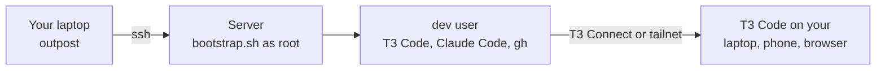

# How outpost works

What outpost does to a server, why, and what each command changes. It follows the same order as the [guide](guide.md): set up, live with it, move on.

## The shape of a run

outpost runs on your laptop and drives the server over your normal `ssh`, so your keys, agent and `~/.ssh/config` all apply. Nothing is installed on your laptop besides the `outpost` binary, and nothing of outpost's runs on the server between commands: the server looks after itself.

## Setting up

`outpost setup` runs six steps:

1. **SSH key.** Uses your existing key or agent, or creates one.
2. **Connect.** Logs in as `dev` if the server is already set up, otherwise as `root`, copying your key over with your root password if needed.
3. **Install.** If the server has no swap, shows its memory and free disk and asks how much to add (`--swap` answers in advance), then makes the swap file. Then uploads `bootstrap.sh` to a private temporary file and runs it as root. It's safe to re-run: each part checks before it changes anything.
4. **Logins.** Each login is skipped if it's already done, so re-runs only ask for what's missing.
5. **Gateway.** On a server that hasn't answered yet, asks whether projects should get HTTPS addresses, and which names (see [below](#the-gateway)). On one that has, checks the gateway and repairs it.
6. **Final check.** Reboots and waits for the server to come back, then confirms T3, Docker and Tailscale are running. A server that already runs T3 may have agents working, so it gets the health check without the reboot.

## What gets installed

| | |
|---|---|
| **T3 Code** | A systemd user service with lingering, so it starts at boot without anyone logging in |
| **Claude Code** | The native install in `~/.local/bin`, signed in with your Claude account |
| **GitHub CLI and git** | Signed in, with `gh auth setup-git` so plain git uses the same login for private repos |
| **Node.js 24** | From NodeSource |
| **Docker** | From get.docker.com, enabled at boot |
| **Tailscale** | Enabled at boot, with Tailscale SSH |
| **Basics** | build-essential, ripgrep, jq, tmux, unzip, ufw |
| **Security updates** | `unattended-upgrades`: daily, security fixes only, never rebooting by itself |
| **Swap** (if you choose it) | `/swapfile`, kept at boot in `/etc/fstab` |

Everything runs as a normal user called **`dev`**, and code lives in `~/code`. Downloads retry, so a brief network drop doesn't fail the install, and apt waits for the daily updates to finish rather than failing on their lock.

## Security

- **SSH:** key-only. Root login is switched off once `dev` has your key, so you can't lock yourself out.
- **Firewall (ufw):** only SSH and traffic on the Tailscale interface get in.
- **Docker:** published ports bind to `127.0.0.1` by default (`/etc/docker/daemon.json`), so `docker run -p 5432:5432 postgres` isn't exposed to the internet. Docker otherwise bypasses ufw.
- **Security updates:** Ubuntu's security fixes install daily. Kernel fixes take effect at the next reboot, which outpost leaves to you so agents aren't cut off; `outpost status` tells you when one is waiting.
- **`dev` has passwordless sudo and Docker access,** so agents running as `dev` can control the whole server. That's intended for a single-person dev box. Keep secrets on it to a minimum.
- **T3 over Tailscale** listens on the tailnet only; ufw blocks the port from the internet, and pairing tokens expire after 5 minutes.
- **Moves and backups never copy logins:** Claude and Codex credentials, and T3's per-process locks, are excluded. Tailscale and GitHub sign-ins live outside the copied folders.
- **Input checks:** server addresses are validated before they reach ssh or a remote shell, sizes are whole numbers, and moves and backups only ever pack their own fixed list of folders.
- **The gateway** listens on the tailnet only. Tailscale names add no listener at all. With your own domain, Caddy listens on `127.0.0.1` alone, reached through the gateway's Tailscale Service, and CoreDNS on the server's tailnet address alone, so neither faces the internet. Its certificate authority can only sign names under your domain, so even a copy of its key can't fake any other site for your devices. The key stays in `~/.outpost/gateway/pki`, readable by `dev` only.
- **The Tailscale API key** outpost may keep for the gateway stays on your laptop (`tailscale-key` in outpost's config folder, readable by you only), never on the server. Delete it to forget it.
- **Optional:** once `ssh dev@<tailscale-name>` works, close public SSH with `sudo ufw delete allow OpenSSH`. Your provider's web console is then your backup way in.

## Living with it

Each command after setup logs in as `dev`, so it needs a server outpost set up. Those that would start T3 (`access`, `login`, `update`) refuse a [retired](#how-a-move-works) server, so two machines never answer as the same environment.

| Command | On the server |
|---|---|
| `status` | Reads memory, swap and disk from `/proc/meminfo` and `df`, `t3 status --json` for access, `systemctl is-active` for the services, each login's own status check, and `/var/run/reboot-required`. Changes nothing. |
| `access` | Runs `t3 up --connect --no-lan` or `t3 up --lan --no-connect` (then `t3 pair --tailscale`, whose `t3code://` link outpost opens here, or whose QR code it shows for another device), which turns the new way on and the old one off. No reinstall, no reboot. |
| `login` | Runs the same sign-in as setup for the named account, even if its status check passes, since a login can look valid after it has expired. With no account, signs in to each one whose check fails. |
| `swap` | As root: turns `/swapfile` off, removes it and its `/etc/fstab` line, then makes, turns on and records one of the new size. Swap from elsewhere, such as a provider's partition, is left alone. Free disk counts the space the old file gives back, and 10 GB always stays free. |
| `gateway` | Asks or reads which names projects get, does the Tailscale admin steps (see [below](#the-gateway)), writes `~/.outpost/gateway`, and publishes each name. Switching takes the old names down first. |
| `gateway add` / `remove` | Checks the project's name, ports and paths, then publishes or removes its names and checks each answers, which also has Tailscale make a new name's certificate. With your own domain, Caddy reloads only if the new config validates. |
| `gateway trust` | Copies the gateway's root certificate to this computer and adds it to the system's trusted roots, asking for your password. On a Mac it also adds `security.enterprise_roots.enabled` to the `user.js` of each Firefox-based browser profile (Firefox, Zen, LibreWolf…), so they trust what the Mac trusts, unless the profile already sets it. |
| `address` | Reads T3's address and the gateway's routes. Changes nothing. |
| `update` | `t3 update --yes`, which restarts T3 on the new version; `claude update`; then `apt-get update` and `upgrade`, keeping config files you changed. |
| `backup` | See [below](#how-a-backup-works). |

## The gateway

Everything lives in `~/.outpost/gateway`, so moves and backups carry it:

| | |
|---|---|
| `gateway.env` | The settings that vary: which names, the domain, the server's suffix, the tailnet, and the gateway Service and its address. Caddy and CoreDNS read it as environment variables. |
| `routes` | One line per name: `project name port [/path=port …]`. Lines that don't check out are ignored, since they reach Caddy, Tailscale and shell commands. |
| `Caddyfile`, `Corefile`, `sites/` | Own domain only: fixed templates, plus a site per project. |
| `pki/DOMAIN/` | Own domain only: the root certificate and key, one per domain, so switching back to a domain needs no new trust. |
| `www/` | Own domain only: the page devices trust it from, and an Apple profile. |

**Tailscale names.** Each name is a Tailscale Service, `svc:NAME-SERVER`, published with `tailscale serve --service`. Tailscale terminates TLS with a real certificate. Paths go to other ports with `--set-path`, and since Tailscale strips a path before passing it on, the target names the path again.

**Your own domain.** One Service, `svc:gateway-SERVER`, gives the gateway a tailnet address of its own with port 443 free (T3 over Tailscale uses 443 on the server's own address). Tailscale passes its ports 443 and 80 to Caddy on `127.0.0.1:44343` and `:44380`. CoreDNS answers every name under the domain with that address, and split DNS sends devices there for it. Caddy and CoreDNS are pinned releases, checked against their published checksums, run as `dev` by the system services `outpost-caddy` and `outpost-dns`, with CoreDNS allowed port 53 and nothing else.

**The Tailscale admin steps**, in order: the policy additions (shown first, and saved only if nobody changed the policy meanwhile), tagging the server `tag:devbox`, defining each Service, publishing them on the server, approving the server as their host, and split DNS. They run through the Tailscale API with your key, or you do them in the admin console as outpost shows each one, and outpost checks them from the server.

**In a move,** the old server stops publishing and the new one takes the same Services over, so addresses and trust stay the same. Split DNS follows the new server's address.

## How a backup works

`outpost backup SERVER [FILE]` packs the same folders as a move, with the same exclusions, and streams the archive over ssh into a file on your laptop. It writes to a hidden temporary file beside `FILE` and renames it only when the download finishes, so a failed backup leaves nothing behind.

T3 keeps threads in SQLite, so outpost stops T3's service for the download, as a move does, and starts it again afterwards, even if the download fails or you press Ctrl-C. A server whose T3 isn't running, such as a retired one, is backed up without being touched.

## How a move works

`outpost move OLD NEW` runs eight steps: SSH key, check the old server, connect to the new one (and confirm), install, move your work, logins, the gateway, final check.

**What moves** is defined in one place, [`manifest.go`](../internal/setup/manifest.go): `~/code`, `~/.t3/userdata` and `~/.t3/worktrees`, `~/.claude` and `~/.claude.json`, `~/.codex`, `~/.gitconfig`, and `~/.outpost` (the gateway). Excluded: credentials, T3's lock files and log contents, and `node_modules`.

**Moving your work:**

1. **Stop T3 on the old server,** so nothing changes mid-copy.
2. **Clear T3's data on the new server,** including any leftover moved-to record.
3. **Stream a tar archive** from the old server to the new one, through your laptop, showing progress. Files that change during the copy (say, from a container) are copied as they were, not treated as an error.
4. **Retire T3 on the old server:** remove its service, keep its files, and write `~/.t3/moved-to` with the new server's address.
5. **Start T3 on the new server.**

If the copy fails, or you press Ctrl-C, T3 starts again on the old server; if even that fails, outpost tells you the command to run.

**Why threads continue:** T3's data folder holds the environment's identity, so the new server is the same environment to T3 Code. outpost always uses the same user and paths, so Claude's session history (stored by project path) lines up, and agents can resume.

**Guards:** a re-run of a finished move skips the copy and doesn't reboot. `setup`, `access`, `login` and `update` refuse a retired server, and moving from a retired server points you to where its work went.

## Reboots

Everything that matters is a systemd service enabled at boot: Docker, Tailscale, ssh, and T3 (a user service, kept running by lingering). Logins and swap are stored on disk. outpost's reboot check proves this on every new server. After a reboot:

- **Comes back:** T3 Code and your threads, Tailscale, Docker, logins, swap, and the gateway's names.
- **Doesn't:** an agent's turn in progress (say "continue"), dev servers, and containers without `restart: unless-stopped`.
